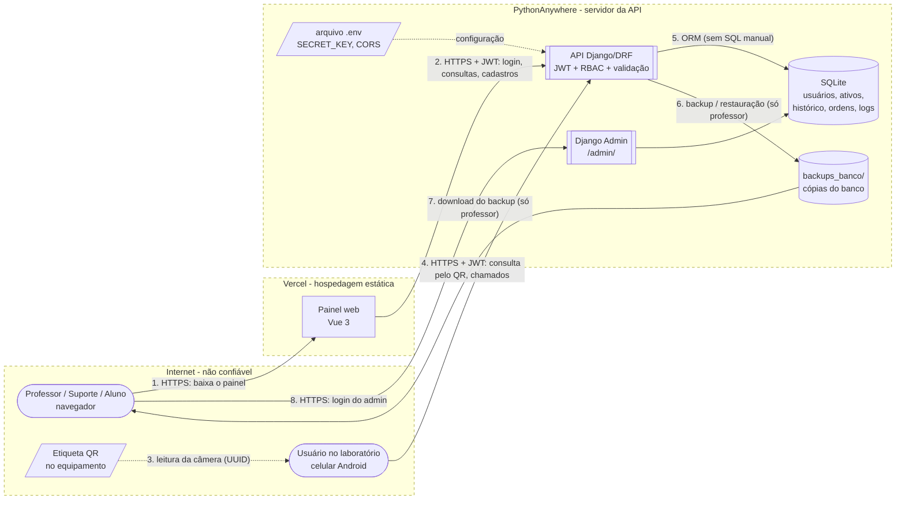

# Segurança do Easy Asset

Riscos do sistema, medidas adotadas, testes que comprovam cada medida, plano de
recuperação e política de segurança. Atende à seção 1.3.1 (Cibersegurança) do
plano de ensino do PI IV.

Escopo: API Django/DRF (este repositório), painel web Vue
([ProjetoIntegrador_Frontend](https://github.com/MiguelSantos1910/ProjetoIntegrador_Frontend))
e aplicativo Flutter
([ProjetoIntegrador_Mobile](https://github.com/MiguelSantos1910/ProjetoIntegrador_Mobile)),
que consomem esta API.

Publicação atual (ver [`deploy.md`](deploy.md)): API em
`https://miguel1910.pythonanywhere.com/api/` (PythonAnywhere) e painel na
Vercel, ambos com HTTPS.

## 1. Ativos de informação

| Ativo | Onde fica | Por que importa |
|---|---|---|
| Contas e senhas (hash) | `auth_user`, `contas_perfil` | Acesso ao sistema e papel de cada pessoa |
| Inventário de ativos | `ativos_ativo` | Patrimônio, localização e situação dos equipamentos |
| Histórico de movimentações | `ativos_historicomovimentacao` | Rastreabilidade: quem mudou o quê e quando |
| Ordens de manutenção e logs | `ordens_manutencao_*` | Controle das manutenções |
| Auditoria de contas | `contas_logconta` | Login, falhas, bloqueios, cadastro, logout e backup |
| Tokens JWT | navegador e app (em memória no app) | Sessão do usuário |
| Backups do banco | `BACKUP_DIR` (padrão `backups_banco/`) | Recuperação; contêm hashes de senha |
| Configuração (`SECRET_KEY`, `DEBUG`, CORS) | variáveis de ambiente / `.env` | Segurança do servidor em produção |

## 2. Lista de riscos e medidas adotadas

Probabilidade (P) e impacto (I): Baixo, Médio ou Alto. "Teste" aponta o teste
automatizado que comprova a medida (`python manage.py test`).

| # | Risco | P | I | Medida adotada | Situação | Teste |
|---|---|---|---|---|---|---|
| R1 | **Força bruta no login** (tentar senhas até acertar) | A | A | Bloqueio por 3 minutos após 5 tentativas erradas, por usuário e IP; evento `LOGIN_BLOQUEADO` | Implementado; tentativas com mais de 1 dia (inclusive de usuários inexistentes) são apagadas | `contas.tests.LoginTestCase.test_bloqueio_na_quinta_tentativa`, `LimpezaTentativasTestCase` |
| R2 | **Acesso sem autenticação** à API | A | A | JWT obrigatório em todas as rotas (`IsAuthenticated` como padrão); só login, renovação, cadastro e `/api/health/` são públicos | Implementado | `test_rotas_protegidas_exigem_token`, `backups.tests.test_sem_login_recebe_401` |
| R3 | **Escalada de privilégio**: autocadastro como professor ou aluno mudando o próprio papel | M | A | Cadastro público cria sempre `ALUNO` e recusa outro papel; só professor altera papéis; só superusuário administra superusuário (senha, papel, desativação, exclusão); ninguém muda o próprio papel nem se desativa | Implementado | `CadastroTestCase.test_cadastro_publico_nao_escolhe_papel`, `PermissoesContasTestCase.test_aluno_nao_se_promove_a_professor`, `test_professor_nao_administra_superusuario`, `test_professor_nao_rebaixa_a_si_mesmo` |
| R4 | **Alteração indevida** de ativos ou ordens por quem não tem permissão | M | A | RBAC no back: aluno só consulta; professor e suporte alteram ativos e ordens; backup só professor. O front apenas esconde botões | Implementado | `ativos.tests.PermissoesAtivosTestCase`, `ordens_manutencao.tests.test_aluno_nao_abre_ordem`, `backups.tests.test_aluno_e_suporte_recebem_403` |
| R5 | **Perda de rastreabilidade**: excluir ativo, ordem ou histórico | M | A | Ninguém exclui pela API (403); ativos são inativados; histórico e logs são somente leitura; mudanças de status geram eventos | Implementado | `test_ativo_nao_pode_ser_excluido`, `test_historico_nao_pode_ser_criado_editado_ou_apagado`, `test_ninguem_exclui_ordem`, `ativos.tests.HistoricoMudancaStatusTestCase` |
| R6 | **Senhas fracas ou expostas** | M | A | Validadores do Django (tamanho mínimo, senha comum, só números, parecida com o usuário); hash PBKDF2; a senha nunca é gravada em log ; a troca da própria senha exige a senha atual | Implementado | `test_senha_fraca_recusada`, `test_cadastro_publico_cria_aluno`, `test_log_nao_grava_a_senha`, `test_propria_senha_exige_senha_atual` |
| R7 | **Sessão reutilizada** após o logout ou token roubado | M | M | Refresh rotacionado e colocado na blacklist; logout invalida o refresh; trocar a senha ou desativar a conta encerra todas as sessões. Access dura 8 h | Parcial: access longo e token no `localStorage` do painel (sensível a XSS) | `LogoutTestCase.test_logout_invalida_o_refresh_token`, `test_troca_de_senha_encerra_sessoes` |
| R8 | **Perda ou corrupção do banco** | M | A | Backup com a API do SQLite, verificação de integridade, retenção, backup automático antes de restaurar, restauração testada e download para guardar uma cópia fora do servidor | Implementado. Na publicação, o disco do PythonAnywhere é persistente; o backup diário é agendado na aba **Tasks** ([`deploy.md`](deploy.md), passo 7) | `backups.tests` (11 testes), [`docs/backup.md`](backup.md) |
| R15 | **Vazamento pelo download do backup**: o arquivo tem os hashes de senha de todos | B | A | Download só para o professor, nome validado (só arquivos do sistema), evento `BACKUP_BAIXADO` na auditoria e resposta sem cache; orientação de guardar a cópia em local privado | Implementado; o cuidado com a cópia baixada depende de quem baixa (política, item 6) | `test_professor_baixa_backup_com_log`, `test_aluno_e_suporte_nao_baixam`, `test_download_so_de_arquivos_do_sistema` |
| R9 | **Interceptação do tráfego**: senha e token trafegando sem criptografia | M | A | API e painel publicados só em **HTTPS** (PythonAnywhere com *Force HTTPS* e Vercel); `SECURE_SSL_REDIRECT`, cookies `Secure` e `SECURE_PROXY_SSL_HEADER` com `DEBUG=False`; o APK aponta para a URL HTTPS | Implementado. Residual: o app mantém `usesCleartextTraffic` só para testar com o back local em HTTP; o `/admin/` do Django continua exposto (protegido por senha, mas sem o bloqueio por tentativas do login da API) | `curl -I http://miguel1910.pythonanywhere.com/api/health/` redireciona para HTTPS |
| R10 | **Configuração insegura em produção**: `SECRET_KEY` padrão, `DEBUG=True`, `ALLOWED_HOSTS=*`, CORS aberto | M | A | Tudo vem do `.env` do servidor ([`.env.producao.example`](../.env.producao.example)): `SECRET_KEY` própria, `DEBUG=False`, `ALLOWED_HOSTS` só com o domínio, CORS só para o painel e `CSRF_TRUSTED_ORIGINS`. Com `DEBUG=False`, o Django **se recusa a subir** com a chave padrão | Implementado. `check --deploy` caiu de 6 avisos para 1 (HSTS, desligado de propósito até o HTTPS estar estável). Origens de teste (ex.: `http://localhost:5555`) devem sair do CORS depois dos testes | `python manage.py check --deploy` |
| R11 | **Segredos ou dados reais no Git** | B | A | `.env`, `db.sqlite3` e `backups_banco/` no `.gitignore`; `.env.example` sem segredos no painel; dados de demonstração fictícios (`seed_ativos`) | Implementado. Observação: um backup antigo ficou no histórico de outro repositório do back; a senha do administrador da AWS foi trocada | — |
| R12 | **Entrada inválida** (status, tipo ou campos fora do esperado) | M | M | Validação nos serializers do DRF (choices, campos obrigatórios, custo não negativo, latitude e longitude em intervalos válidos, patrimônio vazio tratado como nulo); erros 400 com mensagem, sem detalhes internos | Implementado | `test_status_invalido_recusado`, `test_custo_negativo_recusado`, `test_coordenadas_fora_do_intervalo`, `test_varios_ativos_sem_patrimonio` |
| R13 | **Instâncias divergentes**: servidor publicado rodando código diferente do GitHub | A | M | O servidor é um `git clone` do `main`; atualizar é `git pull` + `migrate` + *Reload* ([`deploy.md`](deploy.md), passo 8); a versão final é a tag `v1.0.0` | Implementado. A antiga instância da AWS (`54.20.29.135`) deixou de ser a referência e deve ser desligada | — |
| R14 | **Ações sensíveis sem registro**: mudança de papel e de senha | M | M | Logs de login, falha, bloqueio, logout, cadastro, backup, ordens, status e sala de ativos, mudança de papel, desativação, exclusão de usuário e troca de senha | Implementado | `test_mudanca_de_papel_e_desativacao_geram_log`, `test_exclusao_gera_log`, `test_mudanca_de_sala_gera_evento` |

## 3. Casos de mau uso (objetivo negativo)

| Caso de mau uso | Resultado esperado | Teste |
|---|---|---|
| Consultar ativo sem login | 401 | `test_rotas_protegidas_exigem_token` |
| Aluno alterar a sala de um ativo | 403, sala inalterada | `test_aluno_consulta_mas_nao_altera` |
| Apagar ou editar o histórico | 403 em POST, PATCH e DELETE | `test_historico_nao_pode_ser_criado_editado_ou_apagado` |
| Aluno se promover a professor | 403, papel continua ALUNO | `test_aluno_nao_se_promove_a_professor` |
| Cadastro público como professor | 400, conta não criada | `test_cadastro_publico_nao_escolhe_papel` |
| Trocar a senha de outra pessoa | recusado, senha inalterada | `test_nao_troca_senha_de_outro_usuario` |
| Professor trocar a senha ou desativar o superusuário | 403, conta inalterada | `test_professor_nao_administra_superusuario` |
| Trocar a própria senha sem saber a atual (sessão esquecida aberta) | 400, senha inalterada | `test_propria_senha_exige_senha_atual` |
| Aluno ou suporte ler a auditoria | 403 | `test_auditoria_somente_professor` |
| Restaurar arquivo fora da pasta de backups (`../`) | 400/404, nada restaurado | `backups.tests.test_nome_invalido_ou_inexistente` |
| Aluno ou suporte baixar o banco | 403, nada baixado | `backups.tests.test_aluno_e_suporte_nao_baixam` |
| Baixar outro arquivo do servidor (`db.sqlite3`, `settings.py`) | 400/404 | `backups.tests.test_download_so_de_arquivos_do_sistema` |
| Usar o refresh depois do logout | 401 | `test_logout_invalida_o_refresh_token` |

## 4. Modelo de ameaça (STRIDE resumido)

| Ameaça | Exemplo no sistema | Controle |
|---|---|---|
| **S**poofing (falsificar identidade) | Adivinhar a senha de um professor | Senha validada e com hash, bloqueio por tentativas (R1, R6) |
| **T**ampering (adulterar dados) | Aluno mudando status de ativo | RBAC no back (R4); histórico somente leitura (R5) |
| **R**epudiation (negar a ação) | "Não fui eu que inativei" | Histórico com usuário e data; auditoria de contas (R14) |
| **I**nformation disclosure (vazar dados) | Token capturado em rede aberta | HTTPS na API e no painel (R9); CORS restrito (R10); dados mínimos (seção 7) |
| **D**enial of service (indisponibilidade) | Perda do banco | Backup e restauração (R8); bloqueio limita força bruta |
| **E**levation of privilege (elevar privilégio) | Autocadastro como professor | Cadastro sempre ALUNO, papel só pelo professor (R3) |

### 4.1 Diagrama de fluxo de dados

Elementos, fluxos e **fronteiras de confiança** (as caixas tracejadas). Os
números nas setas ligam cada fluxo às ameaças da tabela abaixo.



| Fluxo / elemento | Ameaças (STRIDE) | Controles |
|---|---|---|
| 2 e 4 — chamadas à API | S, T, I, E | HTTPS; JWT com expiração e blacklist; RBAC no back (R2–R4); validação nos serializers (R12); bloqueio de força bruta no login (R1) |
| 3 — etiqueta QR | T, S | O QR só contém o `codigo_qr` (UUID imutável), sem dados; o app valida o formato e consulta a API; QR falso mostra "não reconhecido" |
| 5 — banco | T, R, I | Só a API acessa; histórico e logs somente leitura e sem exclusão (R5, R14); senhas com hash (R6) |
| 6 e 7 — backups | I, D | Só professor; nome validado contra *path traversal*; download registrado (R8, R15); cópia antes de restaurar |
| 8 — Django Admin | S, E | Senha forte e HTTPS; **residual**: sem bloqueio por tentativas, restringir o acesso é evolução (R9) |
| `.env` | I | Fora do Git; segredos só no servidor (R10, R11) |
| Painel no navegador | I | Token no `localStorage`, sensível a XSS (R7, residual) |

## 5. O que é registrado em log

- **Auditoria de contas** (`/api/contas/auditoria/`, somente professor): `CADASTRO`,
  `CADASTRO_FALHA`, `LOGIN`, `LOGIN_FALHA`, `LOGIN_BLOQUEADO`, `LOGOUT`,
  `SENHA_ALTERADA`, `ALTERACAO_SENHA_FALHA`, `PAPEL_ALTERADO`, `CONTA_DESATIVADA`,
  `CONTA_REATIVADA`, `USUARIO_EXCLUIDO`,
  `BACKUP_CRIADO`, `BACKUP_RESTAURADO`, `BACKUP_BAIXADO` e `BACKUP_FALHA`, com
  usuário, IP e data. Eventos sem usuário (login com usuário inexistente,
  backup pelo terminal) aparecem como "Não identificado".
- **Histórico do ativo**: `CADASTRO`, `MANUTENCAO`, `DEVOLUCAO`, `INATIVO`,
  `REATIVACAO`, `RETORNO` e `MUDANCA_SALA`, com o usuário responsável.
- **Logs da ordem de manutenção**: criação, mudança de status e atualização
  (com os campos alterados).
- **Nunca são gravados**: senha, token ou hash.

## 6. Recuperação de desastres

| Item | Definição |
|---|---|
| O que é copiado | O banco inteiro (ativos, usuários, ordens, históricos e logs) |
| Frequência | Diária, por tarefa agendada no servidor (`backup_banco`; no PythonAnywhere, aba **Tasks**); também sob demanda pelo painel |
| RPO (perda máxima aceitável) | 24 horas, com o backup diário |
| RTO (tempo para voltar a funcionar) | Cerca de 10 minutos: restaurar pelo painel ou pelo terminal |
| Retenção | Os 10 backups mais recentes de cada tipo (`BACKUP_MAX`) |
| Responsável | Professor (pelo painel); quem administra o servidor (cron e cópia externa) |
| Teste de restauração | Automatizado em `backups.tests` (restaurar e conferir o estado, e desfazer a restauração) e roteiro manual com prints em [`docs/backup.md`](backup.md) |

## 7. LGPD

- **Finalidade e necessidade:** só são guardados os dados usados no sistema
  (usuário, nome, e-mail e papel). Não há CPF, endereço nem telefone.
- **Acesso restrito:** a lista de usuários e a auditoria são só do professor;
  aluno e suporte veem apenas a própria conta.
- **Demonstração:** usar apenas dados fictícios (`seed_ativos` e contas de teste).
- **Retenção:** os backups seguem o limite de `BACKUP_MAX`; contas que não são
  mais usadas devem ser desativadas pelo professor.

## 8. Política de Segurança da Informação (resumo)

1. **Contas:** cada pessoa usa a própria conta; não compartilhar usuário e senha.
   Novos cadastros entram como aluno; o professor atribui os demais papéis.
2. **Senhas:** pelo menos 8 caracteres, sem ser só números ou uma senha comum.
   Trocar a senha se houver suspeita de vazamento.
3. **Acesso:** cada papel tem o mínimo necessário: aluno consulta; suporte cuida
   de ativos e ordens; professor administra usuários, auditoria e backup.
4. **Uso aceitável:** o sistema é para a gestão dos ativos do laboratório; não
   usar dados reais de pessoas na demonstração.
5. **Incidentes:** ao notar acesso estranho, bloqueio inesperado ou dado
   alterado, avisar o professor, que consulta a auditoria e, se preciso,
   desativa a conta ou restaura um backup.
6. **Backup:** diário e antes de mudanças grandes; a restauração e o download
   são feitos só pelo professor e ficam registrados. A cópia baixada contém
   hashes de senha: guardar em local privado, nunca no Git ou em pasta
   compartilhada, e apagar as cópias antigas.
7. **Segredos:** nenhuma senha, token ou `.env` no Git; configuração de produção
   apenas por variáveis de ambiente.
8. **Revisão periódica:** a cada entrega (E1 a E5), revisar esta lista de riscos,
   os avisos de `check --deploy` e o resultado dos testes.

## 9. Como verificar

```bash
python manage.py test            # testes de segurança, backup, ativos e ordens
python manage.py check --deploy  # avisos de configuração de produção
```

O pipeline em `.github/workflows/testes.yml` roda os testes em todo push e pull
request.
